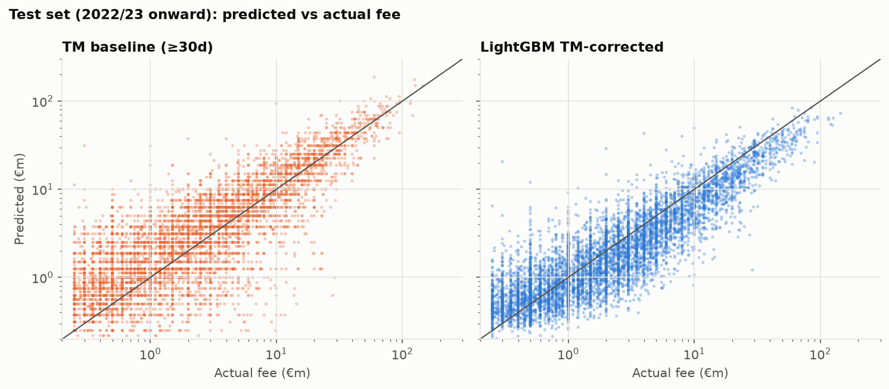
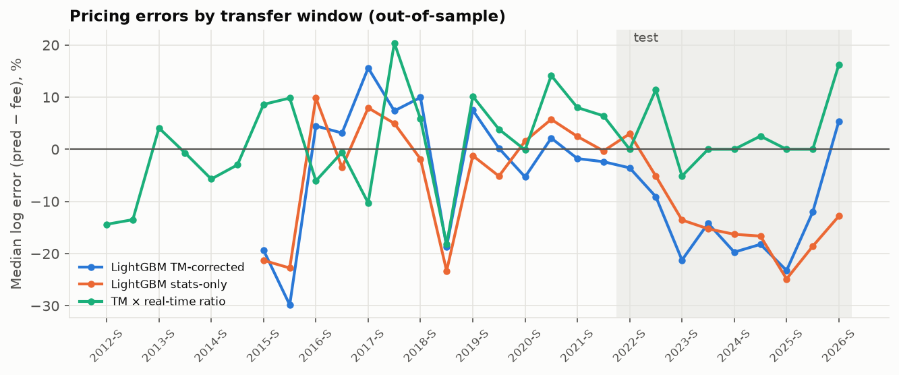
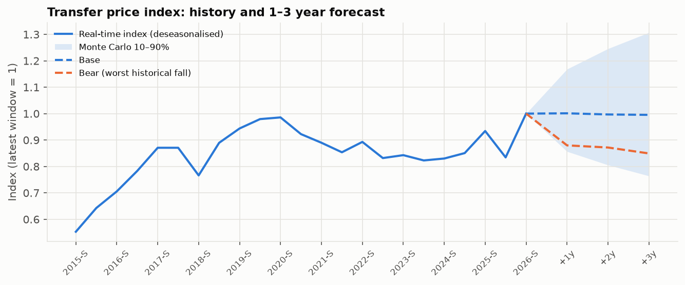

# Final report: test set (checkpoint 3)

**This is the single scoring of the untouched test split** (transfers from 2022-07-01;
snapshots from 2022-07-01). Run at 2026-11-26T23:33:36.
Models were refit exactly as in phase 1/2 (train → early stopping on validation → CQR on calibration);
reproduction check on validation: max |log difference| = 0.0e+00.

## 1. Pricing: test set

Common subset (deals with a TM value ≥ 30 days before):

| model                                       |    n | MdAPE   |   MAE_log | within_25   | within_50   |
|:--------------------------------------------|-----:|:--------|----------:|:------------|:------------|
| TM baseline (≥30d)                          | 7272 | 53.8%   |  0.67151  | 24.6%       | 47.2%       |
| TM × real-time ratio                        | 7272 | 45.6%   |  0.631829 | 30.4%       | 53.3%       |
| Ridge, stats only                           | 7272 | 48.1%   |  0.635491 | 24.4%       | 52.0%       |
| Ridge, with TM                              | 7272 | 40.7%   |  0.530896 | 30.9%       | 61.4%       |
| LightGBM stats-only                         | 7272 | 45.3%   |  0.600619 | 27.3%       | 55.6%       |
| LightGBM TM-corrected                       | 7272 | 38.9%   |  0.513719 | 31.3%       | 64.0%       |
| TM transfers-table value (leaky, reference) | 7268 | 47.9%   |  0.61941  | 29.7%       | 51.2%       |

All test deals (statistical models):

| model                 |    n | MdAPE   |   MAE_log | within_25   | within_50   |
|:----------------------|-----:|:--------|----------:|:------------|:------------|
| Ridge, stats only     | 7406 | 48.2%   |  0.636519 | 24.5%       | 52.0%       |
| Ridge, with TM        | 7406 | 40.9%   |  0.53282  | 30.8%       | 61.2%       |
| LightGBM stats-only   | 7406 | 45.3%   |  0.60131  | 27.2%       | 55.6%       |
| LightGBM TM-corrected | 7406 | 38.9%   |  0.515538 | 31.3%       | 63.9%       |

### Breakdowns (MdAPE, common subset)

**By fee band**

| fee_band   |    n | TM baseline (≥30d)   | TM × real-time ratio   | Ridge, stats only   | Ridge, with TM   | LightGBM stats-only   | LightGBM TM-corrected   |
|:-----------|-----:|:---------------------|:-----------------------|:--------------------|:-----------------|:----------------------|:------------------------|
| <€5m       | 5249 | 66.7%                | 51.6%                  | 46.9%               | 41.0%            | 45.6%                 | 39.9%                   |
| €5–20m     | 1504 | 37.5%                | 36.4%                  | 50.2%               | 41.8%            | 45.0%                 | 37.4%                   |
| €20–50m    |  421 | 25.0%                | 26.6%                  | 51.7%               | 38.9%            | 43.1%                 | 33.2%                   |
| €50m+      |   98 | 17.4%                | 24.5%                  | 39.7%               | 26.7%            | 46.6%                 | 38.2%                   |

**By buying league**

| buying_league   |    n | TM baseline (≥30d)   | TM × real-time ratio   | Ridge, stats only   | Ridge, with TM   | LightGBM stats-only   | LightGBM TM-corrected   |
|:----------------|-----:|:---------------------|:-----------------------|:--------------------|:-----------------|:----------------------|:------------------------|
| Bundesliga      |  444 | 56.3%                | 43.5%                  | 48.8%               | 41.8%            | 46.5%                 | 39.0%                   |
| LaLiga          |  331 | 59.1%                | 46.7%                  | 45.7%               | 36.4%            | 41.5%                 | 33.1%                   |
| Ligue 1         |  446 | 45.8%                | 42.2%                  | 45.5%               | 39.0%            | 44.0%                 | 37.0%                   |
| Other           | 4737 | 59.6%                | 50.0%                  | 49.6%               | 42.2%            | 46.5%                 | 40.4%                   |
| Premier League  |  697 | 36.4%                | 36.4%                  | 49.0%               | 37.9%            | 43.2%                 | 35.8%                   |
| Serie A         |  617 | 45.3%                | 38.8%                  | 41.8%               | 34.6%            | 43.0%                 | 34.8%                   |

**By position group**

| position_group   |    n | TM baseline (≥30d)   | TM × real-time ratio   | Ridge, stats only   | Ridge, with TM   | LightGBM stats-only   | LightGBM TM-corrected   |
|:-----------------|-----:|:---------------------|:-----------------------|:--------------------|:-----------------|:----------------------|:------------------------|
| Attack           | 2729 | 50.0%                | 44.1%                  | 48.4%               | 40.4%            | 46.9%                 | 39.2%                   |
| Defender         | 2085 | 53.4%                | 46.0%                  | 48.1%               | 40.3%            | 43.5%                 | 38.1%                   |
| Goalkeeper       |  380 | 62.5%                | 50.0%                  | 49.8%               | 43.3%            | 45.0%                 | 40.2%                   |
| Midfield         | 2078 | 59.4%                | 46.3%                  | 47.5%               | 41.1%            | 45.4%                 | 38.7%                   |

**By age band**

| age_band   |    n | TM baseline (≥30d)   | TM × real-time ratio   | Ridge, stats only   | Ridge, with TM   | LightGBM stats-only   | LightGBM TM-corrected   |
|:-----------|-----:|:---------------------|:-----------------------|:--------------------|:-----------------|:----------------------|:------------------------|
| ≤20        | 1129 | 50.0%                | 53.8%                  | 51.9%               | 42.5%            | 49.5%                 | 41.2%                   |
| 21–23      | 2327 | 46.4%                | 42.9%                  | 47.0%               | 39.5%            | 43.8%                 | 38.4%                   |
| 24–26      | 2124 | 52.2%                | 40.0%                  | 46.7%               | 39.7%            | 44.0%                 | 37.3%                   |
| 27–29      | 1184 | 75.0%                | 49.9%                  | 47.3%               | 41.4%            | 43.8%                 | 39.5%                   |
| 30+        |  508 | 100.0%               | 64.9%                  | 54.1%               | 43.4%            | 57.7%                 | 43.6%                   |

### Price ranges (80%, CQR)

| model        |   coverage |   below_q10 |   above_q90 |   median_width_ratio |
|:-------------|-----------:|------------:|------------:|---------------------:|
| Stats-only   |       76.5 |         8.9 |        14.7 |                 7.01 |
| TM-corrected |       77.1 |         8.6 |        14.4 |                 5.52 |

### Drift (errors by window, including test windows)

| model                 |   slope_per_year |     t |   windows | flag   |   mean_test_window_bias |
|:----------------------|-----------------:|------:|----------:|:-------|------------------------:|
| LightGBM TM-corrected |           -0.01  | -1.27 |        23 | False  |                  -0.129 |
| LightGBM stats-only   |           -0.011 | -1.57 |        23 | False  |                  -0.134 |
| TM × real-time ratio  |            0.007 |  1.8  |        29 | False  |                   0.028 |

## 2. Evaluators and consensus (test, deals with all three evaluators)

Consensus weights (stacking: convex blend with the lowest validation MAE in logs):
model 0.85, comparables 0.00, crowd 0.15 (validation n = 833; inverse-MAE
weights would have been model 0.42, comparables 0.26, crowd 0.33).

| model                         |    n | MdAPE   |   MAE_log | within_25   | within_50   |
|:------------------------------|-----:|:--------|----------:|:------------|:------------|
| Model (LightGBM TM-corrected) | 7272 | 38.9%   |  0.513719 | 31.3%       | 64.0%       |
| Comparables (K=10)            | 7272 | 62.2%   |  0.830601 | 19.5%       | 39.3%       |
| Crowd (TM × real-time ratio)  | 7272 | 45.6%   |  0.631829 | 30.4%       | 53.3%       |
| Consensus                     | 7272 | 37.8%   |  0.501294 | 32.4%       | 65.4%       |

Does disagreement between evaluators signal uncertainty? Consensus error by evaluator-spread quartile:

| spread_band   |    n | consensus_MdAPE   |   median_spread_log |
|:--------------|-----:|:------------------|--------------------:|
| low           | 1818 | 36.1%             |                0.39 |
| mid-low       | 1818 | 37.1%             |                0.73 |
| mid-high      | 1818 | 39.2%             |                1.05 |
| high          | 1818 | 39.5%             |                1.65 |

Book value (estimate; last fee into the selling club written off over 5 years) is available for
74% of held-out deals; median fee / book value = 3.30. It is a floor indicator only.

## 3. 12-month value forecast (test snapshots, player part = TM change minus TM market move)

| model                 |     n |   MAE |   RMSE |   R2_vs_no_change |   spearman | direction_hit_|y|>0.1   |
|:----------------------|------:|------:|-------:|------------------:|-----------:|:------------------------|
| no change             | 24145 | 0.463 |  0.599 |             0     |            | 0.0%                    |
| age curve             | 24145 | 0.387 |  0.517 |             0.255 |      0.436 | 72.6%                   |
| LightGBM              | 24145 | 0.374 |  0.508 |             0.282 |      0.489 | 74.8%                   |
| 80% interval coverage | 24145 | 0.799 |        |                   |            |                         |

(For the interval row, `MAE` holds the empirical coverage.)

## 4. Undervalued-signal backtest (test snapshots)

Flag = model median ÷ current TM value in the top decile on each snapshot date.

| flag                       |   players |   with_12m_TM_value | median_12m_TM_change   |   median_12m_change_vs_age_curve | share_sold_12m   |   median_sale_fee_over_TM |   median_age |
|:---------------------------|----------:|--------------------:|:-----------------------|---------------------------------:|:-----------------|--------------------------:|-------------:|
| others                     |     23616 |               21961 | -15.4%                 |                            0.026 | 16.7%            |                      0.87 |         26.3 |
| flagged (top 10% model/TM) |      2627 |                2184 | +0.0%                  |                            0.048 | 10.4%            |                      1.25 |         23.9 |

Difference in median 12-month TM change (flagged − others): +0.167 log
points (bootstrap 90% CI +0.154 to +0.182); flagged group ahead on 86% of
test snapshot dates.

**Age-adjusted** (player part of the change minus the age-curve expectation, so the flag is not simply
"young players"): flagged − others = +0.022 log points (90% CI +0.002 to +0.042).

## 5. Contract adjustment (forward-chained inside the test period)

Fitted on the main model's log residual (years left capped at 4, ≤ 1 year flag, age), on earlier test
seasons only, scored on the next. **Uses test-period labels after the frozen test scoring above.**

| season   | fit_on      |   n | MdAPE_main   | MdAPE_with_contract   |   beta_years_left |   beta_le1y |
|:---------|:------------|----:|:-------------|:----------------------|------------------:|------------:|
| 24/25    | 22/23–23/24 | 792 | 38.4%        | 35.5%                 |             0.038 |      -0.181 |
| 25/26    | 22/23–24/25 | 856 | 38.1%        | 34.1%                 |             0.058 |      -0.215 |
| 26/27    | 22/23–25/26 | 101 | 40.5%        | 41.0%                 |             0.053 |      -0.221 |

## 6. Market forecast

One-year-ahead backtest of the real-time index (log points; `MAE_common` = same origins for all):

| model               |   n |   MAE |   RMSE |   bias |   MAE_common |   n_common |
|:--------------------|----:|------:|-------:|-------:|-------------:|-----------:|
| no change           |  21 | 0.088 |  0.113 | -0.041 |        0.063 |         15 |
| random walk + drift |  17 | 0.113 |  0.14  |  0.09  |        0.093 |         15 |
| revenue-linked      |  15 | 0.108 |  0.147 |  0.005 |        0.108 |         15 |

|   horizon_years | origin   |    p10 |   base |   bull |   bear | bear_from   | bear_to   | drift_mode   |
|----------------:|:---------|-------:|-------:|-------:|-------:|:------------|:----------|:-------------|
|               1 | 2026-S   | -0.155 |  0.001 |  0.156 | -0.128 | 2017-S      | 2018-S    | zero         |
|               2 | 2026-S   | -0.216 | -0.003 |  0.22  | -0.137 | 2020-W      | 2022-W    | zero         |
|               3 | 2026-S   | -0.269 | -0.005 |  0.268 | -0.163 | 2020-W      | 2023-W    | zero         |

## 7. Post-test diagnosis (written after scoring; nothing was tuned on the test set)

**Finding: the LightGBM models under-price test-period deals by ~13% (median), worst in 2023–25
(−15% to −25% per window), while TM × real-time ratio stays unbiased.** The drift test over all 23
windows did not flag it (|t| < 2) because the bias appears only at the end, so the per-window plot
matters more than the slope test here.

- It is broad: core-14-league buyers −17% to −24% (2023–25) as well as newly covered leagues.
- Cause (diagnosed, not fixed): the **market index falls in the test period** (median deflator level
  +0.10 in 2022 → −0.04 in 2023–25) while the TM market level and the fee/TM ratio show prices holding
  or rising. Money predictions = real value × index, so the index error passes straight through.
- Likely mechanism (hypothesis): the dataset's match coverage expanded to many more *selling* leagues in
  2024–25, so newly observed players suddenly have minutes/experience data; the hedonic model attributes
  their fees to measured quality instead of the market level, understating price growth.
- Candidate fixes (for a new hold-out, not this test): control the hedonic index for data coverage
  (selling-league coverage flags; estimate on sellers covered since 2012), anchor the nowcast more
  strongly to the TM-level movement, and/or blend more weight on the crowd value in new windows. For
  current valuations (phase 4) the model is refit through 2025, which re-learns the recent level.
