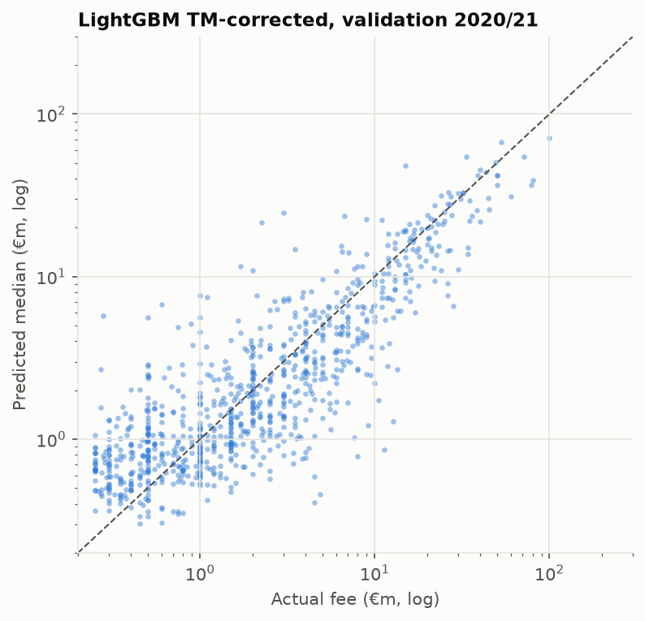
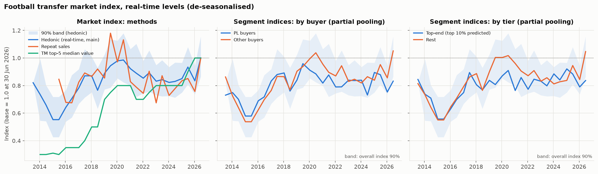
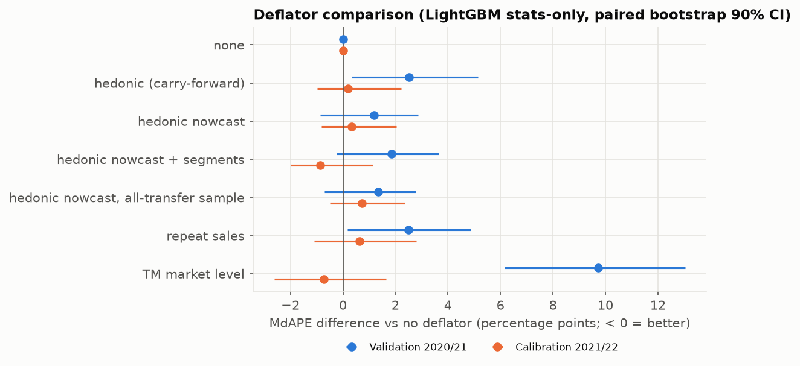
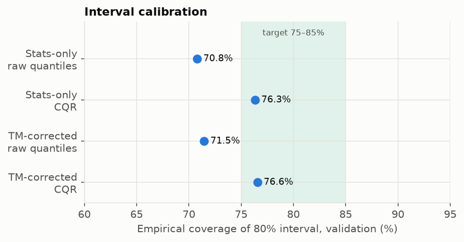
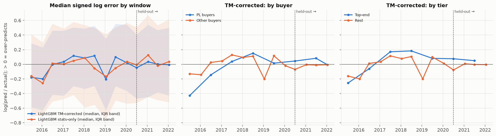
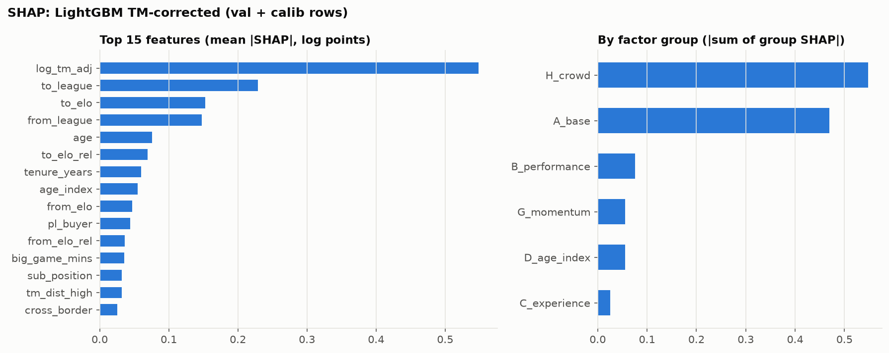
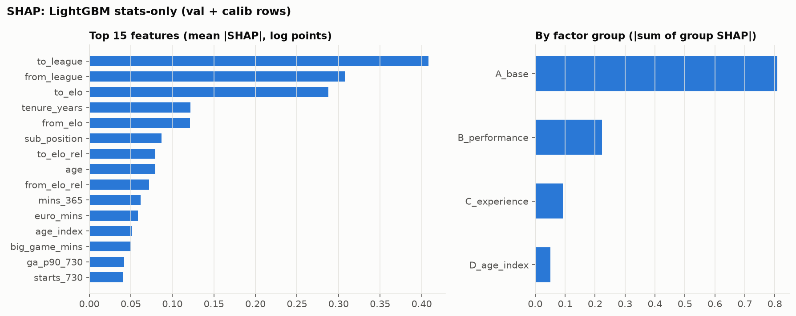
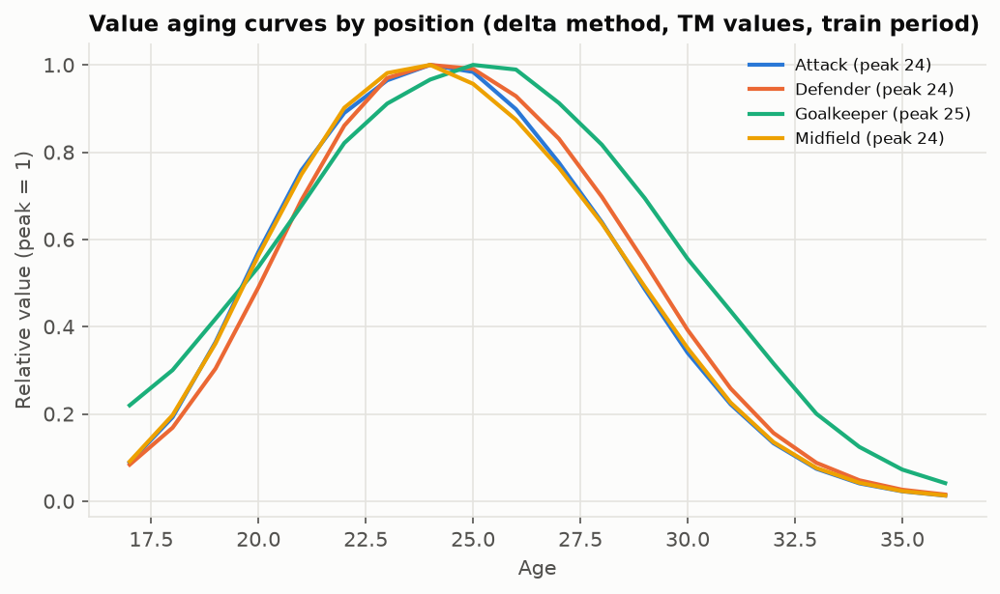

# Model report — Phase 1 (validation only)

*Generated by `make evaluate`. The test split (transfers from 2022-07-01) has not been
scored. All numbers below are validation (2020/21) unless stated.*

## Setup

* Universe: permanent transfers with known fee ≥ €250,000, July 2012 → July 2026.
* Splits: train < 2020-07-01 · validation → 2021-07-01 ·
  calibration → 2022-07-01 · test after (untouched).
* Target: real value = log(fee) − log(market index). Deflator used: **hedonic nowcast**
  (see the market-index section for why this overrides the pure validation rule).
* Predictions are medians (exp of predicted log). MdAPE = median |pred / fee − 1|.
* Fees are in EUR as recorded; GBP uses the ECB rate on the transfer date. Currency check: see
  `reports/data_audit.md` section 7 (fees agreed in £ were converted at the rate of the day; no
  restatement at a single recent rate).

### Filter funnel

| filter                                          |   rows remaining |   removed |
|:------------------------------------------------|-----------------:|----------:|
| all transfer rows                               |           175165 |         0 |
| dated on/before data cutoff 2026-07-06          |           174645 |       520 |
| dated on/after training-window start 2012-07-01 |           161819 |     12826 |
| fee known (not NaN)                             |           106901 |     54918 |
| fee > 0 (drops loans, end-of-loan, free)        |            16908 |     89993 |
| fee >= €250,000                                 |            14360 |      2548 |
| selling club != buying club                     |            14360 |         0 |
| de-duplicated                                   |            14360 |         0 |

## 1. Headline metrics (validation 2020/21)

Common subset where a Transfermarkt value ≥30 days before the deal exists (n = 833):

| model                                       |   n | MdAPE   |   MAE_log | within_25   | within_50   |
|:--------------------------------------------|----:|:--------|----------:|:------------|:------------|
| TM baseline (≥30d)                          | 833 | 50.9%   |     0.694 | 25.9%       | 47.9%       |
| TM × real-time ratio                        | 833 | 50.0%   |     0.689 | 26.9%       | 49.9%       |
| Ridge, stats only                           | 833 | 51.7%   |     0.684 | 23.6%       | 48.3%       |
| Ridge, with TM                              | 833 | 44.0%   |     0.581 | 28.1%       | 56.4%       |
| LightGBM stats-only                         | 833 | 46.7%   |     0.636 | 27.6%       | 54.0%       |
| LightGBM TM-corrected                       | 833 | 39.5%   |     0.55  | 30.1%       | 60.3%       |
| TM transfers-table value (leaky, reference) | 833 | 44.4%   |     0.642 | 28.8%       | 53.1%       |

All validation rows (n = 883; the TM baseline cannot price rows without a TM value):

| model                 |   n | MdAPE   |   MAE_log | within_25   | within_50   |
|:----------------------|----:|:--------|----------:|:------------|:------------|
| Ridge, stats only     | 883 | 52.3%   |     0.694 | 22.9%       | 47.0%       |
| Ridge, with TM        | 883 | 44.7%   |     0.596 | 27.2%       | 55.3%       |
| LightGBM stats-only   | 883 | 47.5%   |     0.646 | 27.0%       | 52.7%       |
| LightGBM TM-corrected | 883 | 40.8%   |     0.565 | 29.4%       | 58.6%       |

TM baseline scale factor (fit on train, as the brief specifies): ×1.250.
"TM × real-time ratio" instead multiplies the TM value by the median fee/TM ratio of deals in the prior
365 days (known in real time). The ratio was ~1.2–1.4 in 2012–20 and ~1.0 from 2021: Transfermarkt
values caught up with fees after COVID, so a fixed train-period factor over-prices later deals. The
TM-corrected model uses the same real-time-adjusted TM value (`log_tm_adj`).

### Breakdowns (MdAPE, common subset)

**By fee band**

| fee_band   |   n | TM baseline (≥30d)   | TM × real-time ratio   | Ridge, stats only   | Ridge, with TM   | LightGBM stats-only   | LightGBM TM-corrected   |
|:-----------|----:|:---------------------|:-----------------------|:--------------------|:-----------------|:----------------------|:------------------------|
| <€5m       | 594 | 56.3%                | 54.2%                  | 50.9%               | 46.2%            | 48.1%                 | 43.4%                   |
| €5–20m     | 179 | 40.6%                | 39.3%                  | 54.4%               | 41.3%            | 46.9%                 | 36.4%                   |
| €20–50m    |  51 | 26.1%                | 29.1%                  | 46.8%               | 27.9%            | 37.0%                 | 20.9%                   |
| €50m+      |   9 | 13.2%                | 16.6%                  | 25.9%               | 18.0%            | 28.5%                 | 27.6%                   |

**By buying league**

| buying_league   |   n | TM baseline (≥30d)   | TM × real-time ratio   | Ridge, stats only   | Ridge, with TM   | LightGBM stats-only   | LightGBM TM-corrected   |
|:----------------|----:|:---------------------|:-----------------------|:--------------------|:-----------------|:----------------------|:------------------------|
| Bundesliga      |  47 | 40.6%                | 36.5%                  | 52.1%               | 47.3%            | 42.9%                 | 40.3%                   |
| LaLiga          |  53 | 42.7%                | 45.8%                  | 41.4%               | 38.2%            | 39.4%                 | 36.4%                   |
| Ligue 1         |  64 | 50.0%                | 43.1%                  | 53.0%               | 39.7%            | 49.2%                 | 36.0%                   |
| Other           | 487 | 57.1%                | 55.0%                  | 51.1%               | 46.0%            | 47.5%                 | 42.0%                   |
| Premier League  |  85 | 48.1%                | 44.5%                  | 57.6%               | 39.0%            | 45.1%                 | 31.6%                   |
| Serie A         |  97 | 41.1%                | 39.4%                  | 52.0%               | 39.2%            | 46.8%                 | 36.5%                   |

**By position group**

| position_group   |   n | TM baseline (≥30d)   | TM × real-time ratio   | Ridge, stats only   | Ridge, with TM   | LightGBM stats-only   | LightGBM TM-corrected   |
|:-----------------|----:|:---------------------|:-----------------------|:--------------------|:-----------------|:----------------------|:------------------------|
| Attack           | 298 | 50.7%                | 52.0%                  | 52.7%               | 41.9%            | 48.6%                 | 39.0%                   |
| Defender         | 240 | 52.2%                | 52.2%                  | 49.3%               | 46.5%            | 45.6%                 | 39.8%                   |
| Goalkeeper       |  43 | 48.4%                | 44.0%                  | 51.8%               | 38.5%            | 43.6%                 | 37.7%                   |
| Midfield         | 252 | 52.0%                | 44.8%                  | 52.5%               | 42.8%            | 46.3%                 | 43.1%                   |

**By age band**

| age_band   |   n | TM baseline (≥30d)   | TM × real-time ratio   | Ridge, stats only   | Ridge, with TM   | LightGBM stats-only   | LightGBM TM-corrected   |
|:-----------|----:|:---------------------|:-----------------------|:--------------------|:-----------------|:----------------------|:------------------------|
| ≤20        | 142 | 59.6%                | 61.4%                  | 55.9%               | 46.9%            | 55.1%                 | 49.6%                   |
| 21–23      | 280 | 40.8%                | 39.3%                  | 51.7%               | 45.4%            | 47.7%                 | 42.6%                   |
| 24–26      | 226 | 50.0%                | 48.0%                  | 46.6%               | 37.1%            | 40.8%                 | 33.1%                   |
| 27–29      | 143 | 70.5%                | 62.8%                  | 48.7%               | 46.0%            | 43.8%                 | 36.6%                   |
| 30+        |  42 | 66.7%                | 57.0%                  | 54.4%               | 57.5%            | 48.6%                 | 47.5%                   |

## 2. Market index

The main index is a rolling hedonic regression (two windows per year) estimated on buyers in the 14
leagues covered since 2012, with a real-time nowcast (carried level + TM-level movement + shrunk
mean residual of the current window's earlier deals). Segment indices are partial-pooling deviations
(pseudo-count 50). Bands: ±1.645 standard errors of the window effect.

**Method comparison.** Each deflator was used to build the target for LightGBM stats-only (default
params), and the predictions converted back to money:

| split   | deflator                             |    n |   MdAPE |   diff_vs_none |   diff_90lo |   diff_90hi |
|:--------|:-------------------------------------|-----:|--------:|---------------:|------------:|------------:|
| val     | none                                 |  883 |    47.1 |            0   |         0   |         0   |
| val     | hedonic (carry-forward)              |  883 |    49.6 |            2.5 |         0.3 |         5.1 |
| val     | hedonic nowcast                      |  883 |    48.3 |            1.2 |        -0.9 |         2.9 |
| val     | hedonic nowcast + segments           |  883 |    48.9 |            1.8 |        -0.2 |         3.7 |
| val     | hedonic nowcast, all-transfer sample |  883 |    48.4 |            1.4 |        -0.7 |         2.8 |
| val     | repeat sales                         |  883 |    49.6 |            2.5 |         0.2 |         4.9 |
| val     | TM market level                      |  883 |    56.8 |            9.7 |         6.1 |        13   |
| calib   | none                                 | 1105 |    48.1 |            0   |         0   |         0   |
| calib   | hedonic (carry-forward)              | 1105 |    48.3 |            0.2 |        -1   |         2.2 |
| calib   | hedonic nowcast                      | 1105 |    48.5 |            0.3 |        -0.8 |         2   |
| calib   | hedonic nowcast + segments           | 1105 |    47.3 |           -0.9 |        -2   |         1.1 |
| calib   | hedonic nowcast, all-transfer sample | 1105 |    48.9 |            0.7 |        -0.5 |         2.4 |
| calib   | repeat sales                         | 1105 |    48.8 |            0.6 |        -1.1 |         2.8 |
| calib   | TM market level                      | 1105 |    47.4 |           -0.7 |        -2.6 |         1.6 |

*(MdAPE and differences in percentage points.)* On validation the lowest MdAPE is **no deflator**, but
its lead over the hedonic nowcast is within noise (90% CI includes 0), and on calibration all methods
are tied. Prices in 2020–22 sat close to the training-period average, so an index cannot show its value
there; it matters when the model has to price at levels outside its training range (test period and
current valuations). The TM market level is clearly worst on validation. **Decision flagged for the
user:** keep the hedonic nowcast (current setting) or follow the validation rule (no deflator).

## 3. Price ranges (conformalized quantile regression)

| model        | interval      |   below_q10 |   above_q90 |   coverage |   median_width_ratio |
|:-------------|:--------------|------------:|------------:|-----------:|---------------------:|
| Stats-only   | raw quantiles |        16.5 |        12.7 |       70.8 |                 6.49 |
| Stats-only   | CQR           |        13.3 |        10.4 |       76.3 |                 8    |
| TM-corrected | raw quantiles |        14.8 |        13.7 |       71.5 |                 5.16 |
| TM-corrected | CQR           |        12.7 |        10.8 |       76.6 |                 6.2  |

`median_width_ratio` = median of (upper / lower) bound. CQR offsets were fit on the calibration split
(stats-only q̂ = 0.105, TM-corrected q̂ = 0.091 log points)
and are evaluated here on validation, which is held out from both training and calibration.

## 4. Diagnostics: errors by window and segment

Training windows use expanding-window out-of-fold predictions (fit on earlier windows only); validation
and calibration windows use the held-out predictions. Drift test = OLS slope of window median errors on
time (flag if |t| > 2):

| model                 | segment      |   slope_per_year |    t |   windows | flag   |
|:----------------------|:-------------|-----------------:|-----:|----------:|:-------|
| LightGBM TM-corrected | all          |            0.015 | 1.03 |        14 | False  |
| LightGBM TM-corrected | PL buyers    |            0.051 | 2.16 |         8 | True   |
| LightGBM TM-corrected | Other buyers |            0.004 | 0.31 |        14 | False  |
| LightGBM TM-corrected | Top-end      |            0.039 | 1.51 |         7 | False  |
| LightGBM TM-corrected | Rest         |            0.011 | 0.79 |        14 | False  |
| LightGBM stats-only   | all          |            0.024 | 1.9  |        14 | False  |

Windows with fewer than 30 deals are excluded. **Drift found and partly fixed:** a first
run flagged upward drift overall (the model over-priced post-2020 deals by ~10%). Cause: the median
fee / TM-value ratio was ~1.2–1.4 in 2012–20 and ~1.0 from 2021, so TM values learned at the training
ratio over-price later deals. Using the real-time ratio (`log_tm_adj`) removed the overall drift.
**Still flagged:** PL buyers (only 8 windows with ≥30 deals):
under-priced in 2015–17 (the Premier League TV-deal surge), close to zero since. The segmented
deflator is the candidate fix; it was the best deflator on calibration but within noise.

## 5. Explanations (SHAP)

Group importance, TM-corrected:

| group         |   mean_abs_shap |
|:--------------|----------------:|
| H_crowd       |           0.548 |
| A_base        |           0.47  |
| B_performance |           0.075 |
| G_momentum    |           0.056 |
| D_age_index   |           0.055 |
| C_experience  |           0.025 |

## 6. Features and components

* **Club strength:** own two-level Elo from 88,216 club games (ClubElo API unreachable). Tuned on
  pre-2020-07-01 games: K_club = 8, K_league = 8,
  home advantage = 50. Match-outcome MSE 0.1629 vs 0.1908 naive.
* **Age index:** delta-method curves by position (train-period TM values, demeaned by year).

* Feature groups in this phase: A_base, B_performance, C_experience, D_age_index, G_momentum, H_crowd. Hype (E), availability (F) and pace/profile (I)
  arrive in phase 2.

## 7. Caveats

* Early stopping used the validation split (as the brief specifies), so validation metrics are slightly
  optimistic for the LightGBM models; hyper-parameters were tuned with CV inside training only.
* Validation is the COVID-affected 2020/21 season.
* Appearance data begin in 2012-07: career features are left-truncated (experience is normalised by
  observable years) and about half of all transfers have no appearance data in the prior year
  (players from leagues outside the dataset).
* Club Elo is our own; leagues with few cross-league games (e.g. Brazil, Saudi Arabia) have no
  absolute rating (within-league standing only).
