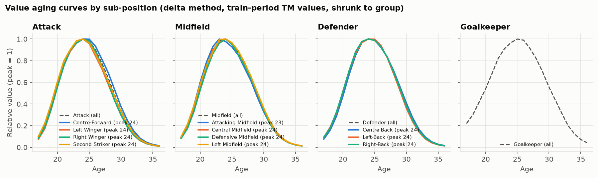
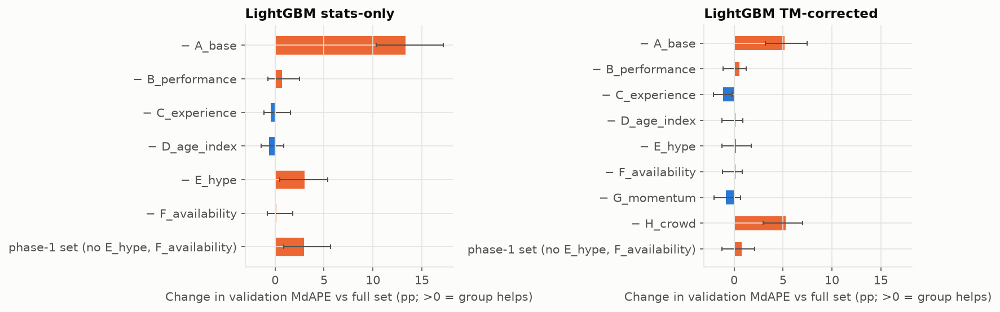

# Phase 2 report: extra factors (checkpoint 2)

Validation (2020/21) and calibration (2021/22) only. The test split is untouched.

## 1. Source status

| source | status | used for |
|---|---|---|
| Wikidata SPARQL (P2446) | ✅ working | TM id → English Wikipedia article |
| Wikimedia page views API | ✅ working (HTTP 429 above ~1 req/s; we honour Retry-After) | group E hype |
| Kaggle versions of transfermarkt-datasets | ✅ working (range requests, players.csv only) | contract history |
| Understat | ❌ **down**: every page returns a "We will come back soon" maintenance page | xG / xA (group B) |
| SoFIFA | ❌ **blocked**: Cloudflare "Attention Required" (HTTP 403) for automated requests | pace, archetypes (group I) |

Per the brief, Understat- and SoFIFA-dependent work (xG features, archetypes, pace decline curves) is
**paused pending your decision**; nothing has been faked or filled in.

## 2. Entity matching: Transfermarkt → Wikidata → English Wikipedia

| check                                         | value           |
|:----------------------------------------------|:----------------|
| Wikidata item found (all queried TM ids)      | 22,815 / 26,639 |
| … with an English Wikipedia article           | 19,781          |
| Transfer-universe rows with an article        | 98.9%           |
| … for fees ≥ €5m                              | 100.0%          |
| Date of birth agrees exactly (Wikidata vs TM) | 96.7%           |
| Date of birth within a year                   | 99.76%          |

Spot-check, 20 random matches (TM name, Wikipedia article, both dates of birth):

|   player_id | name                   | article               | wd_dob     | tm_dob     |
|------------:|:-----------------------|:----------------------|:-----------|:-----------|
|      105506 | Vladimir Obukhov       | Vladimir_Obukhov      | 1992-02-08 | 1992-02-08 |
|      960057 | Juan Córdoba           | Juan_Córdoba          | 2003-07-11 | 2003-07-11 |
|      342065 | Erhan Erentürk         | Erhan_Erentürk        | 1995-05-30 | 1995-05-30 |
|      638188 | Yilmar Velásquez       | Yilmar_Velásquez      | 1999-08-21 | 1999-08-21 |
|      333355 | Milad Mohammadi        | Milad_Mohammadi       | 1993-09-29 | 1993-09-29 |
|       65467 | Vicente Iborra         | Vicente_Iborra        | 1988-01-16 | 1988-01-16 |
|      495722 | Devis Vásquez          | Devis_Vásquez         | 1998-05-12 | 1998-05-12 |
|      649317 | Jhon Durán             | Jhon_Durán            | 2003-12-13 | 2003-12-13 |
|      364133 | Pietro Pellegri        | Pietro_Pellegri       | 2001-03-17 | 2001-03-17 |
|      447482 | Dagur Dan Thórhallsson | Dagur_Dan_Þórhallsson | 2000-05-02 | 2000-05-02 |
|      442531 | Edouard Mendy          | Édouard_Mendy         | 1992-03-01 | 1992-03-01 |
|      799924 | Asker Beck             | Asker_Beck            | 2003-07-07 | 2003-07-07 |
|     1018754 | Samuel Gidi            | Samuel_Gidi           | 2004-04-15 | 2004-04-15 |
|      685795 | Marius Ștefănescu      | Marius_Ștefănescu     | 1998-08-14 | 1998-08-14 |
|      833268 | Alonso Aceves          | Alonso_Aceves         | 2001-03-28 | 2001-03-28 |
|      163222 | Grégoire Defrel        | Grégoire_Defrel       | 1991-06-17 | 1991-06-17 |
|     1129400 | Sander Kilen           | Sander_Kilen          | 2005-05-30 | 2005-05-30 |
|      538810 | Chris Ramos            | Chris_Ramos           | 1997-01-15 | 1997-01-18 |
|      486481 | Ronald Rodríguez       | Ronald_Rodríguez      | 1998-09-22 | 1998-09-22 |
|      547187 | Léo Cordeiro           | Léo_Cordeiro          | 1995-09-27 | 1995-09-27 |

## 3. Inferred unavailability (group F; **not confirmed injuries**)

Absence spells from matchday squads (lineups from July 2013): a regular (≥ 45 min average over his last
10 squads) missing ≥ 3 consecutive club matches with lineup data; the match after a red card is
excused; runs with no return are counted only at the player's current club. 55% of transfers have
lineup history (the rest come from leagues the dataset does not cover).

| feature                 |   count |    mean |    10% |   50% |   90% |
|:------------------------|--------:|--------:|-------:|------:|------:|
| avail_365               |    7942 |   0.959 |  0.857 |     1 |     1 |
| avail_730               |    8905 |   0.964 |  0.877 |     1 |     1 |
| avail_1095              |    9325 |   0.966 |  0.884 |     1 |     1 |
| spell_mins_missed_365   |    7942 | 141.788 |  0     |     0 |   540 |
| long_spells_24m         |    9325 |   0.193 |  0     |     0 |     1 |
| months_since_long_spell |    9325 |  50.465 | 13.022 |    60 |    60 |
| spell_recurrence        |    9325 |   0.024 |  0     |     0 |     0 |
| unavail_now             |    9325 |   0.032 |  0     |     0 |     0 |

Sanity check, Ousmane Dembélé before his August 2023 move (known record: hamstring Sept 2017 and Jan
2018, Nov 2019 – Aug 2020, knee 2021, hamstring Feb 2023):

| start      | end        |   matches |
|:-----------|:-----------|----------:|
| 2017-09-19 | 2017-12-23 |        20 |
| 2018-01-17 | 2018-02-08 |         7 |
| 2019-03-17 | 2019-04-06 |         4 |
| 2019-12-01 | 2020-08-08 |        32 |
| 2020-12-08 | 2020-12-22 |         5 |
| 2021-08-15 | 2021-10-30 |        14 |
| 2023-02-01 | 2023-04-26 |        17 |

## 4. Profile-aware aging curves (group D)

Sub-position curves use the delta method on training-period TM values, with each age's mean change
shrunk toward the position-group curve (pseudo-count 200). **Value** peaks at 23–25 everywhere; the
profiles differ in how fast value falls after the peak (wingers fastest, centre-backs slower,
goalkeepers slowest). `age_index` now uses the sub-position peak and a new feature `age_curve_fwd2` is
the curve's expected 2-year change. Archetype curves and pace decline curves need SoFIFA / Understat.

## 5. Contract history feasibility

| transfer_season   |   transfers | covered   |   median_years_left |   median_snapshot_age_days |
|:------------------|------------:|:----------|--------------------:|---------------------------:|
| 22/23             |         465 | 28%       |                1.44 |                          8 |
| 23/24             |        1784 | 43%       |                1.42 |                         10 |
| 24/25             |        1922 | 41%       |                1.83 |                          7 |
| 25/26             |        2075 | 41%       |                1.49 |                        130 |
| 26/27             |         141 | 72%       |                0.5  |                         99 |

Snapshot = latest Kaggle `players.csv` dated before the transfer in which the player is at the selling
club (135 versions, Nov 2022 → Sep 2026, mostly weekly; **the source has no snapshot between
11 Apr 2025 and 14 Feb 2026**, so summer-2025 deals use April 2025 contracts). Coverage is ~40% because
many selling clubs are outside the dataset's squad coverage or have no contract date.

The signal is strong. Fee relative to the TM value (≥ 30 days before) by years left:

| years_left   |   n |   median_log_fee_over_tm | fee_vs_tm   |
|:-------------|----:|-------------------------:|:------------|
| ≤0.5         | 568 |                   -0.267 | -23%        |
| 0.5–1        | 605 |                   -0.336 | -29%        |
| 1–1.5        | 193 |                   -0.182 | -17%        |
| 1.5–2        | 517 |                    0     | +0%         |
| 2–3          | 486 |                    0.134 | +14%        |
| 3+           | 275 |                    0.196 | +22%        |

**Proposal for checkpoint 2** (all contract data lies in the test period, from Dec 2022):
1. In phase 3, score the main models on the test set **once**, as planned, without contract data, and
   freeze those results.
2. Then fit the contract adjustment (a small model on the main model's residual: years left, age, fee
   band) forward-chained inside 2022/23–2025/26 (fit on earlier seasons, score the next), and report it
   separately and clearly labelled as using test-period labels.
3. Refit it on all 2022/23–2025/26 deals for current valuations.

## 6. Ablation (does each group help?)

| model                 | variant                                 |   val_MdAPE |   val_diff_vs_full |   val_diff_90lo |   val_diff_90hi |   calib_MdAPE |   calib_diff_vs_full |
|:----------------------|:----------------------------------------|------------:|-------------------:|----------------:|----------------:|--------------:|---------------------:|
| LightGBM stats-only   | full                                    |        46.8 |                0   |             0   |             0   |          45.5 |                  0   |
| LightGBM stats-only   | − A_base                                |        60.2 |               13.3 |            10.3 |            17.2 |          52.8 |                  7.3 |
| LightGBM stats-only   | − B_performance                         |        47.6 |                0.7 |            -0.7 |             2.5 |          44.7 |                 -0.8 |
| LightGBM stats-only   | − C_experience                          |        46.4 |               -0.5 |            -1.1 |             1.5 |          45.8 |                  0.3 |
| LightGBM stats-only   | − D_age_index                           |        46.2 |               -0.6 |            -1.5 |             0.9 |          45.5 |                 -0   |
| LightGBM stats-only   | − E_hype                                |        49.9 |                3   |             0.5 |             5.4 |          47.9 |                  2.4 |
| LightGBM stats-only   | − F_availability                        |        46.9 |                0.1 |            -0.8 |             1.8 |          44.8 |                 -0.7 |
| LightGBM stats-only   | phase-1 set (no E_hype, F_availability) |        49.8 |                2.9 |             0.9 |             5.7 |          48.7 |                  3.2 |
| LightGBM TM-corrected | full                                    |        41.1 |                0   |             0   |             0   |          38.6 |                  0   |
| LightGBM TM-corrected | − A_base                                |        46.3 |                5.2 |             3.2 |             7.5 |          42.8 |                  4.2 |
| LightGBM TM-corrected | − B_performance                         |        41.7 |                0.6 |            -1.1 |             1.2 |          39.7 |                  1.1 |
| LightGBM TM-corrected | − C_experience                          |        40   |               -1.1 |            -2.1 |            -0.2 |          39.7 |                  1.1 |
| LightGBM TM-corrected | − D_age_index                           |        41.3 |                0.1 |            -1.3 |             0.9 |          40.4 |                  1.9 |
| LightGBM TM-corrected | − E_hype                                |        41.4 |                0.2 |            -1.2 |             1.7 |          41   |                  2.4 |
| LightGBM TM-corrected | − F_availability                        |        41.3 |                0.2 |            -1.2 |             0.8 |          39.9 |                  1.3 |
| LightGBM TM-corrected | − G_momentum                            |        40.3 |               -0.8 |            -2.1 |             0.7 |          39.4 |                  0.9 |
| LightGBM TM-corrected | − H_crowd                               |        46.4 |                5.3 |             3   |             7   |          45.4 |                  6.8 |
| LightGBM TM-corrected | phase-1 set (no E_hype, F_availability) |        41.9 |                0.8 |            -1.3 |             2.1 |          40.8 |                  2.3 |

LightGBM with the full model's tuned parameters, mean of 3 seeds; paired-bootstrap 90% intervals.
